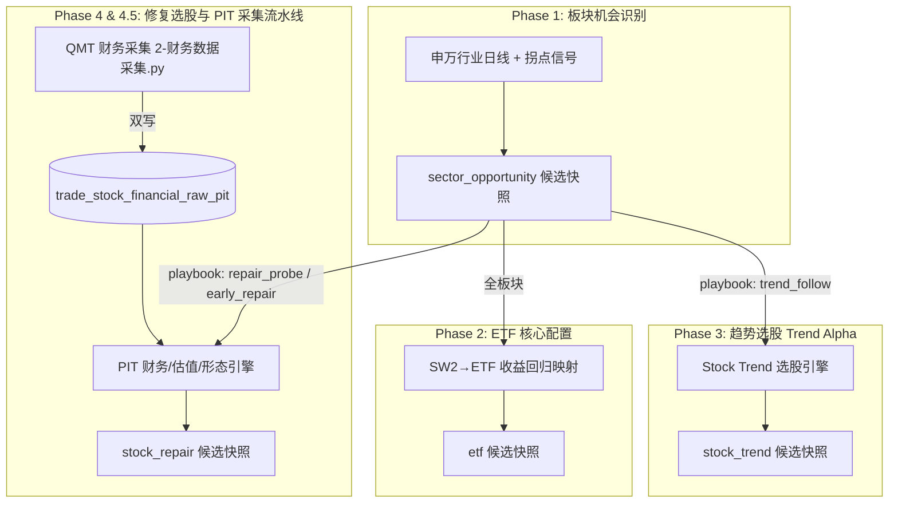

# 板块研究驾驶舱使用指南

## Phase 1-4 补强后的运行约束

- Trend/Repair 快照是不可变研究记录；算法或参数变更必须使用新的 `model_version` 或 `config_hash`，禁止删除式覆盖和 `--force-replace`。
- `--dry-run` 只在内存中计算，不执行 schema DDL、不写运行日志、不写业务表。
- Repair 默认严格 PIT：每个报告期只使用 `announcement_date <= as_of_date` 的最新版本；`PIT_ESTIMATED` 仅在显式传入 `--allow-estimated-pit` 时使用。
- Trend 缺少 ADX、流动性、相对强度持久性等核心特征时输出 `data_quality_blocked`，不会静默降权为可用候选。
- 历史回填使用 `BACKFILL`，与 `LIVE_SHADOW` 共存；两者均保留用于审计和回放。

> **适用范围**：`morning_conference.sector_rotation2.research` 体系全链路：板块机会（Phase 1）、SW2→ETF 候选（Phase 2）、趋势个股 Alpha（Phase 3）、修复/价值个股 Alpha（Phase 4）以及数据采集与 PIT 自动化流水线（Phase 4.5）。
> **运行原则**：先生成上游板块机会快照，再并行或顺序产出下游 ETF 候选、趋势个股候选与修复个股候选。
> **成熟度说明**：所有下游输出均为研究影子输出：`SHADOW` / `MANUAL_ONLY`，用于研究可视化与推演，不直接触发自动化实盘交易。

---

## 0. 运行边界与全链路架构

驾驶舱覆盖从“宏观板块机会”到“ETF / 个股多策略标的”的全阶段流水线：



### 全阶段目标与产出一览

| 阶段 | 模块定位 | 触发条件 / 上游依赖 | 正式输入表 | 主要产出快照 (`strategy_type`) |
| :--- | :--- | :--- | :--- | :--- |
| **Phase 1** | 申万板块机会识别 | 每日盘后全量行业扫描 | `trade_sector_daily`、行业衍生信号 | `sector_opportunity` (Sector) |
| **Phase 2** | SW2→ETF 收益映射与配置 | Phase 1 板块快照 | `trade_sector_daily`、`trade_stock_daily` (ETF) | `etf` (ETF Candidate) 及 `trade_sector_etf_map` |
| **Phase 3** | 顺势突破/领涨个股 Alpha | Phase 1 Playbook 为 `trend_follow` 的强势板块 | `trade_stock_daily_qfq`、`trade_stock_status` | `stock_trend` (Stock Trend Candidate) |
| **Phase 4** | 困境反转/修复个股 Alpha | Phase 1 Playbook 为 `repair_probe` / `early_repair` 的修复板块 | `trade_stock_financial_raw_pit`、`trade_stock_capital_pit`、`trade_stock_daily` | `stock_repair` (Stock Repair Candidate) |
| **Phase 4.5** | 数据采集与 PIT 自动化管道 | 每日盘后定时任务 / 存量迁移 | QMT 数据源 / `trade_stock_financial` 存量表 | 自动填充 PIT 财务原始表与一键调度 |

---

## 1. 运行前环境与数据检查

在仓库根目录执行基础环境确认：

```powershell
Set-Location D:\aiQuant\ai_quant_sys
$env:PYTHONPATH = 'src'
git log -1 --oneline
python -c "import morning_conference.sector_rotation2 as m; print(m.__file__)"
```

### 1.1 核心数据表与依赖检查

```sql
-- 1. 统一研究快照主表
SHOW TABLES LIKE 'research_candidate_snapshot';

-- 2. Phase 2 ETF 映射表
SHOW TABLES LIKE 'trade_sector_etf_map';

-- 3. Phase 4 PIT 财务与股本表
SHOW TABLES LIKE 'trade_stock_financial_raw_pit';
SHOW TABLES LIKE 'trade_stock_capital_pit';
SHOW TABLES LIKE 'trade_stock_valuation_daily';

-- 4. 检查行情与状态数据最新日期
SELECT MAX(trade_date) AS latest_sw2_date FROM trade_sector_daily WHERE sector_level = 2;
SELECT MAX(trade_date) AS latest_stock_date FROM trade_stock_daily;
```

---

## 2. Phase 1：生成板块机会快照 (Sector Opportunity)

### 2.1 当天实时影子运行 (`LIVE_SHADOW`)
```powershell
$d = (Get-Date -Format 'yyyy-MM-dd')
python -m morning_conference.sector_rotation2.research.orchestrator.run_daily `
  --as-of-date $d --level 2
```

### 2.2 历史回填 (`BACKFILL`)
```powershell
$d = '2026-08-18'
python -m morning_conference.sector_rotation2.research.orchestrator.run_daily `
  --backfill-start $d --backfill-end $d --level 2
```

### 2.3 验收 Phase 1 输出
```sql
SELECT
  as_of_date, sector_name, candidate_status,
  JSON_EXTRACT(feature_json, '$.playbook') AS playbook,
  model_version, snapshot_mode, created_at
FROM research_candidate_snapshot
WHERE as_of_date = '2026-08-18'
  AND entity_type = 'sector'
  AND strategy_type = 'sector_opportunity'
ORDER BY sector_name;
```

---

## 3. Phase 2：刷新 ETF 映射与生成 ETF 候选

### 3.1 刷新正式 SW2→ETF 收益回归映射
对每个 SW2 与本地权益 ETF，基于 60 个连续共同交易日日线收益进行回归拟合，每个行业最多保留 3 只 ETF：

```powershell
$d = '2026-08-18'
$hash = 'return-regression-v1'

python -m morning_conference.sector_rotation2.research.etf_core.refresh_return_mapping `
  --as-of-date $d --level 2 --config-hash $hash `
  --window 60 --min-samples 50
```

### 3.2 生成 ETF 候选快照
* **当天运行**：
  ```powershell
  python -m morning_conference.sector_rotation2.research.etf_core.run_daily --as-of-date (Get-Date -Format 'yyyy-MM-dd') --level 2
  ```
* **历史回填**：
  ```powershell
  python -m morning_conference.sector_rotation2.research.etf_core.run_daily --backfill-start 2026-08-18 --backfill-end 2026-08-18 --level 2
  ```

### 3.3 验收 ETF 候选
```sql
SELECT
  entity_code, sector_name, candidate_status,
  risk_flags_json, feature_json, snapshot_mode
FROM research_candidate_snapshot
WHERE as_of_date = '2026-08-18'
  AND entity_type = 'etf'
  AND strategy_type = 'etf'
ORDER BY sector_name, entity_code;
```

---

## 4. Phase 3：Stock Trend Alpha 趋势选股引擎

### 4.1 核心算法与打分模型
Phase 3 专门针对 Phase 1 中标记为 **`trend_follow`** 的强势顺势板块，在行业内部筛选具备超额收益与形态支撑的领涨股：

1. **六维 Alpha 评分合成**：
   * 行业相对超额强度 (`alpha_strength`, 35%)：5日/10日/20日 相对行业超额收益加权。
   * 领跑持续性 (`persistence`, 20%)：过去 10 日中处于板块前 30% 收益的分位数占比。
   * 趋势质量 (`trend_quality`, 20%)：Kaufman 效率比率 (ER) 与 ADX 趋势强度。
   * 技术结构评分 (`structure`, 10%)：均线多头排列 (`ma_stack`)、20日/60日突破、缩量强势回踩。
   * 流动性支撑 (`liquidity`, 10%)：20 日日均成交额分位数。
   * 连板龙头加成 (`hot_leader_bonus`, 5%)：PIT-safe 涨停与连板溢价加分。
2. **多维风险扣分 (`risk_penalty`)**：乖离率过大扩展惩罚 (`extension_penalty`) + 高特质波动率扣分。
3. **候选状态分类 (`candidate_status`)**：
   * `TREND_LEADER`：顺势领涨龙头（高 Alpha + 突破结构）。
   * `TREND_PULLBACK`：强势顺势回踩（多头排列 + 缩量回踩 MA20）。
   * `HOT_LEADER`：强动量连板龙头。
   * `RISK_WATCH`：高风险或乖离过大观察标的。

### 4.2 运行 Trend Alpha

* **当天实时影子运行**：
  ```powershell
  python -m morning_conference.sector_rotation2.research.stock_alpha.run_trend_daily `
    --as-of-date (Get-Date -Format 'yyyy-MM-dd') --level 2 --mode live_shadow
  ```
* **历史单日回填**：
  ```powershell
  python -m morning_conference.sector_rotation2.research.stock_alpha.run_trend_daily `
    --as-of-date 2026-08-18 --level 2 --mode backfill
  ```
* **指定单行业测试 / Dry-run**：
  ```powershell
  python -m morning_conference.sector_rotation2.research.stock_alpha.run_trend_daily `
    --as-of-date 2026-08-18 --level 2 --mode backfill --sector "半导体" --dry-run
  ```

### 4.3 验收 Trend 候选快照
```sql
SELECT
    as_of_date,
    entity_code,
    sector_name,
    rank_in_sector,
    candidate_status,
    candidate_score,
    JSON_EXTRACT(feature_json, '$.attribution') AS attribution,
    JSON_EXTRACT(feature_json, '$.risk_penalties') AS risk_penalties
FROM research_candidate_snapshot
WHERE as_of_date = '2026-08-18'
  AND strategy_type = 'stock_trend'
ORDER BY sector_name, rank_in_sector ASC
LIMIT 30;
```

---

## 5. Phase 4 & 4.5：Stock Repair / Value Alpha 修复选股与数据采集流水线

### 5.1 核心算法与 PIT 点时间机制
Phase 4 针对 Phase 1 中标记为 **`repair_probe`** 或 **`early_repair`** 的左侧修复/反转板块进行个股筛选：

1. **严格点时间（PIT）无未来函数保障**：
   * **公告日截面控制**：严格满足 `announcement_date <= as_of_date`，禁止未到披露日的季报提前可见。
   * **Restatement 历史重述隔离**：保留原始披露历史，回测优先取截面可见的非更正版本。
   * **PIT 真实市值**：$\text{Market Cap} = \text{raw\_close} \times \text{shares\_pit}$（截面未复权收盘价 $\times$ 当时实际总股本）。
2. **TTM 归一化与估值边界保护**：
   * 自动拼接最近 4 季度报表合成 TTM 指标；不足 4 季度返回 `None`。
   * **负 PE 保护**：归母净利润 $\le 0$ 时 PE 强行置空，杜绝将亏损股误判为低估值。
   * **金融板块 PB 停用**：银行、非银金融等资产负债表特殊板块，PB 自动置空并打上标记。
3. **价值陷阱识别与扣分 (`value_trap_penalty`)**：
   * 业绩持续恶化（连续同比负增长）、高杠杆负债风险、现金流枯竭累加扣分（0.0 ~ 1.0）。
4. **候选状态分类 (`candidate_status`)**：
   * `REPAIR_VALUE`：高性价比估值 + 良好财务质量 + 底部技术形态构筑。
   * `TURNAROUND`：困境反转高质量修复。
   * `WATCH`：左侧观察序列。
   * `VALUE_TRAP` / `VALUE_TRAP_RISK`：低估值但财务恶化，拦截警示。

### 5.2 数据库准备与存量数据迁移

1. **执行表结构迁移**：
   ```bash
   mysql -u root -p wucai_trade < sql/20260820_create_repair_alpha_persistence_tables.sql
   ```
2. **老表数据一次性回填（如果原 `trade_stock_financial` 已有存量数据）**：
   ```bash
   mysql -u root -p wucai_trade < sql/20260821_migrate_trade_stock_financial_to_pit.sql
   ```

### 5.3 Phase 4.5 财务数据采集与双写机制 (Dual-Write)
运行 `src/data_ingestion/2-财务数据采集.py` 采集最新财报时，系统已内置 **双写（Dual-Write）** 逻辑：
* **表 1（老宽表兼容）**：写入 `trade_stock_financial`（`ON DUPLICATE KEY UPDATE`）。
* **表 2（Phase 4 PIT 原始表）**：通过 [`FinancialRawStore.insert_raw()`](file:///D:/aiQuant/ai_quant_sys/src/morning_conference/sector_rotation2/research/financial/raw_store.py) 写入 `trade_stock_financial_raw_pit`，自动生成 `source_hash` 指纹并打上 `pit_estimated` 标记。

```powershell
# 运行财务采集（同时写老表与 PIT 表）
python "src/data_ingestion/2-财务数据采集.py"
```

### 5.4 运行 Repair Alpha 选股
* **单日 Dry-run 验证（不落库）**：
  ```powershell
  python -m morning_conference.sector_rotation2.research.stock_alpha.run_repair_daily `
    --as-of-date 2026-08-18 --level 2 --mode backfill --dry-run
  ```
* **正式历史回填落库**：
  ```powershell
  python -m morning_conference.sector_rotation2.research.stock_alpha.run_repair_daily `
    --as-of-date 2026-08-18 --level 2 --mode backfill
  ```
* **强制覆盖同日历史数据 (`--force-replace`)**：
  ```powershell
  python -m morning_conference.sector_rotation2.research.stock_alpha.run_repair_daily `
    --as-of-date 2026-08-18 --level 2 --mode backfill --force-replace
  ```

### 5.5 Phase 4.5 统一日常流水线调度 (`run_daily_pipeline`)
使用统一调度入口，一条命令自动完成 **“财报采集 $\rightarrow$ Repair Alpha 选股与落库”**（支持 Windows 计划任务或 Crontab 每日 17:00 调用）：

* **日常盘后实时运行 (`live_shadow`)**：
  ```powershell
  python -m data_ingestion.run_daily_pipeline --level 2 --mode live_shadow
  ```
* **历史回填（包含 legacy estimated 财报）**：
  ```powershell
  python -m data_ingestion.run_daily_pipeline --as-of-date 2026-08-18 --mode backfill --allow-estimated-pit
  ```

### 5.6 验收 Repair 候选快照
```sql
SELECT
    as_of_date,
    entity_code,
    sector_name,
    candidate_status,
    candidate_score,
    JSON_EXTRACT(feature_json, '$.attribution') AS attribution,
    JSON_EXTRACT(feature_json, '$.qualitative_flags') AS flags
FROM research_candidate_snapshot
WHERE as_of_date = '2026-08-18'
  AND strategy_type = 'stock_repair'
ORDER BY candidate_score DESC
LIMIT 30;
```

---

## 6. 幂等性、版本隔离与冲突处理规则

1. **快照不可变规则（Immutability）**：
   * 统一主键唯一约束：`(as_of_date, entity_type, entity_code, strategy_type, model_version, config_hash, snapshot_mode)`。
   * 在相同的模型版本与配置哈希下，同日相同快照再次写入时会自动校验兼容性；若内容发生变更，系统会抛出 `SnapshotConflictError` 保护历史数据。
2. **强制重刷机制 (`--force-replace`)**：
   * 当修复了算法 Bug 或更新了底层特征需要重新覆盖同日历史快照时，在 CLI 命令中显式传入 `--force-replace`，runner 会先安全清空旧快照再写入新版本。
3. **板块与成分股精准隔离**：
   * Phase 3 与 Phase 4 在打分时自动通过 `trade_stock_status` 的 `sector_2` 映射仅加载当前板块所管辖的成分股，避免全市场跨行业重复打分和唯一索引冲突。

---

## 7. 常见问题与排错指南 (FAQ)

### 7.1 `Unknown column 'source_verified' in 'field list'`
* **原因**：本地 `trade_stock_financial_raw_pit` 表缺少数据可信度验证列。
* **解决**：重新应用 `sql/20260820_create_repair_alpha_persistence_tables.sql`，或执行：
  ```sql
  ALTER TABLE trade_stock_financial_raw_pit ADD COLUMN source_verified TINYINT(1) NOT NULL DEFAULT 0 AFTER is_restated;
  ```

### 7.2 `Unknown column 'entity_name' in 'field list'`
* **原因**：`research_candidate_snapshot` 统一使用 `entity_code` 存储代码、`sector_name` 存储所属板块，无 `entity_name` 独立列。
* **解决**：SQL 查询中使用 `entity_code, sector_name`。

### 7.3 `persisted 0 backfill repair candidates across N sectors`
* **原因**：
  1. `trade_stock_financial_raw_pit` 中尚无该日期的财务记录。
  2. 使用了 `--dry-run` 参数（仅内存计算，不写库）。
* **解决**：确认原始财报表已有数据（可运行存量迁移 SQL），并去掉 `--dry-run` 正式落库。

### 7.4 `non-today --as-of-date requires BACKFILL mode`
* **原因**：非当天日期使用了默认的 `live_shadow` 模式，系统触发防回填污染保护。
* **解决**：历史日期命令加上 `--mode backfill`。

---

## 8. 完整流水线最小验收顺序 (Phase 1 $\rightarrow$ 4.5)

在执行全量生产回填或日常盘后运行时，推荐执行顺序如下：

```powershell
$d = '2026-08-18'

# 1. 运行 Phase 1 行业机会快照
python -m morning_conference.sector_rotation2.research.orchestrator.run_daily --backfill-start $d --backfill-end $d --level 2

# 2. 运行 Phase 2 SW2→ETF 收益回归映射与 ETF 候选
python -m morning_conference.sector_rotation2.research.etf_core.refresh_return_mapping --as-of-date $d --level 2 --config-hash return-regression-v1
python -m morning_conference.sector_rotation2.research.etf_core.run_daily --backfill-start $d --backfill-end $d --level 2

# 3. 运行 Phase 3 顺势股票 Trend Alpha 候选 (对应 trend_follow 板块)
python -m morning_conference.sector_rotation2.research.stock_alpha.run_trend_daily --as-of-date $d --level 2 --mode backfill

# 4. 运行 Phase 4 / 4.5 修复股票 Repair Alpha 候选 (或通过 run_daily_pipeline 统一调度)
python -m data_ingestion.run_daily_pipeline --as-of-date $d --level 2 --mode backfill --allow-estimated-pit

# 5. 一键检查全套 402 个单元与集成测试
python -m pytest tests/research/ -v
```

### 全阶段汇总核对 SQL：
```sql
SELECT
    as_of_date,
    strategy_type,
    entity_type,
    candidate_status,
    COUNT(*) AS candidate_count
FROM research_candidate_snapshot
WHERE as_of_date = '2026-08-18'
GROUP BY as_of_date, strategy_type, entity_type, candidate_status
ORDER BY strategy_type, candidate_count DESC;
```

---

## 9. 延迟运行快照：迁移、日跑与验收

`delayed_shadow` 用于次日批处理的行情研究，不重算、删除或覆盖既有 `backfill` / `live_shadow` 快照。其时间均以 `Asia/Shanghai` 解释：行情数据在信号日 18:00 后可得；研报或公告类数据在下一交易日 00:00 可得。日线评价只在运行严格早于 09:30 时使用当日开盘；09:30 或之后完成时顺延至下一交易日开盘。

### 9.1 一次性加性迁移

在维护窗口仅执行一次以下迁移。它只增加可空列与索引，不回写候选、特征、评分或既有评价记录；执行前后应核对候选行数和既有 `backfill` 评价口径保持不变。

```powershell
mysql -u root -p wucai_trade < sql/20260825_add_research_snapshot_availability.sql
```

### 9.2 后续次日批处理

以 T 日为 `$d`，先生成同模式的 Phase 1 根快照，再生成 ETF、趋势与修复候选；四个步骤必须使用相同的 `delayed_shadow` 模式。不要用 `backfill` 根快照替代 delayed 根快照。

```powershell
$d = '2026-08-24'

python -m morning_conference.sector_rotation2.research.orchestrator.run_daily --as-of-date $d --level 2 --mode delayed_shadow
python -m morning_conference.sector_rotation2.research.etf_core.run_daily --as-of-date $d --level 2 --mode delayed_shadow
python -m morning_conference.sector_rotation2.research.stock_alpha.run_trend_daily --as-of-date $d --level 2 --mode delayed_shadow
python -m morning_conference.sector_rotation2.research.stock_alpha.run_repair_daily --as-of-date $d --level 2 --mode delayed_shadow
```

每条新 `delayed_shadow` 快照必须具备 `data_available_at`、`run_at`、`execution_eligible_at` 与 `availability_basis`。驾驶舱按所选模式查询，不会跨模式回退；`backfill` 的旧记录显示为历史快照，不伪造运行时刻。

### 9.3 只读验收

以下命令均不写候选或评价数据。`verify_backfill` 的 `mode_mismatch_count` 与 `delayed_missing_metadata_count` 必须为 0；`availability_null_counts` 中历史 `backfill` 的空值是预期现象。

```powershell
$env:PYTHONPATH = 'src'
python -m morning_conference.sector_rotation2.research.evaluation.verify_backfill
python -m morning_conference.sector_rotation2.research.evaluation.verify_evaluation
```
